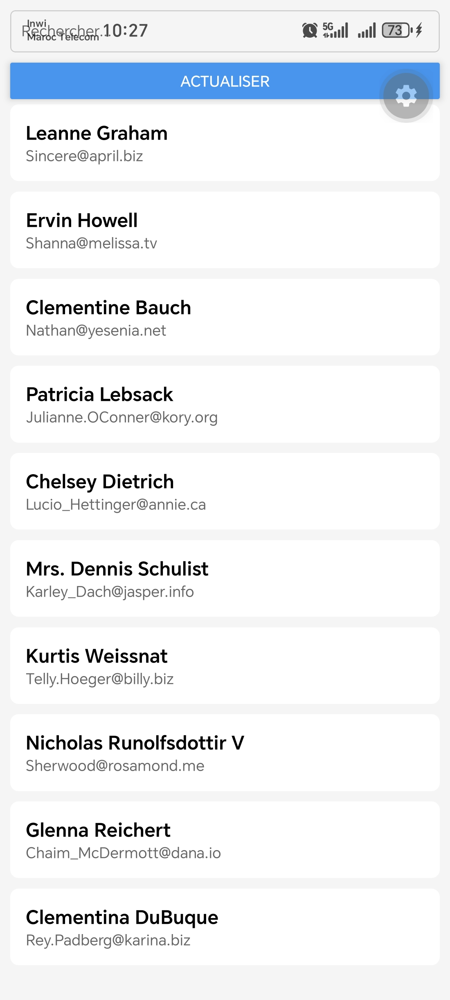
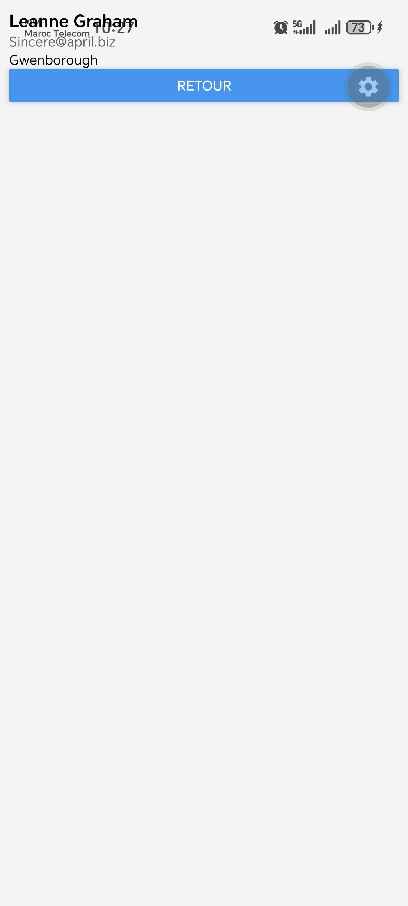
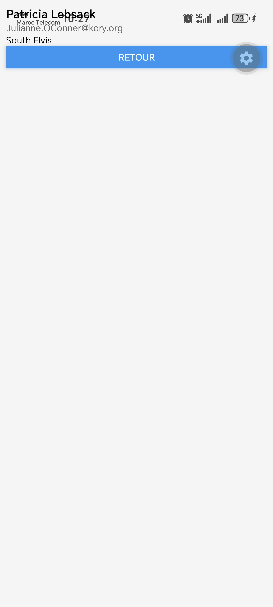

# Lab 11 — Consommation d’une API REST

Liste des utilisateurs chargée depuis JSONPlaceholder.

Première fiche d’utilisateur avec son nom, son e-mail et sa ville.

Deuxième fiche d’utilisateur ouverte depuis la liste.

